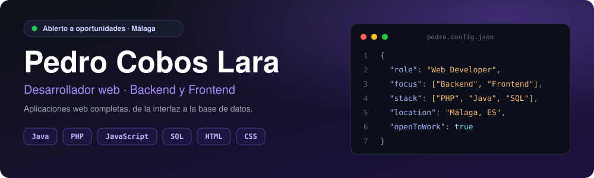

<picture>
  <source media="(prefers-color-scheme: dark)" srcset="assets/banner-dark.svg">
  <source media="(prefers-color-scheme: light)" srcset="assets/banner-light.svg">
  
</picture>

Desarrollador de aplicaciones web con base en Málaga, formado en **Desarrollo de Aplicaciones Web (DAW)**. Construyo aplicaciones completas, desde la interfaz hasta la base de datos, y me gusta que el código sea **claro, ordenado y fácil de mantener**. Abierto a oportunidades como desarrollador backend, frontend o full stack.

---

## 🛠️ Tecnologías

- **Frontend:** HTML, CSS, JavaScript
- **Backend:** PHP, Java
- **Bases de datos:** SQL
- **Herramientas:** Git, GitHub, Shopify

---

## 🎯 Intereses

- **Backend:** lógica de negocio, bases de datos y APIs.
- **Frontend:** interfaces claras, responsive y accesibles.
- Aprender a unir ambas partes en aplicaciones completas y a explorar nuevas tecnologías.

---

## 🚀 Proyectos destacados

Tres herramientas web que he creado para **Nocturne Souls**, mi marca de ropa. Comparten la misma identidad visual.

<table>
  <tr>
    <td width="33%" valign="top">
      <h3><a href="https://github.com/PedroCobosLara/nocturne-pricing">🧮 Nocturne Pricing</a></h3>
      
Calculadora de precios y márgenes: tiene en cuenta coste de producción, envío, comisiones e IVA.

      
<code>HTML</code> <code>CSS</code> <code>JavaScript</code>

    </td>
    <td width="33%" valign="top">
      <h3><a href="https://github.com/PedroCobosLara/nocturne-orders">📦 Nocturne Orders</a></h3>
      
Panel web con login para gestionar pedidos: importación desde CSV, estados, filtros y estadísticas de ventas.

      
<code>PHP</code> <code>SQL</code> <code>HTML</code> <code>CSS</code> <code>JavaScript</code>

    </td>
    <td width="33%" valign="top">
      <h3><a href="https://github.com/PedroCobosLara/nocturne-insights">📊 Nocturne Insights</a></h3>
      
Aplicación web en Java que calcula el beneficio real por producto y por mes y lo muestra en un panel con gráficos.

      
<code>Java</code> <code>SQL</code> <code>HTML</code> <code>CSS</code> <code>JavaScript</code>

    </td>
  </tr>
</table>

---

## 📫 Contacto

